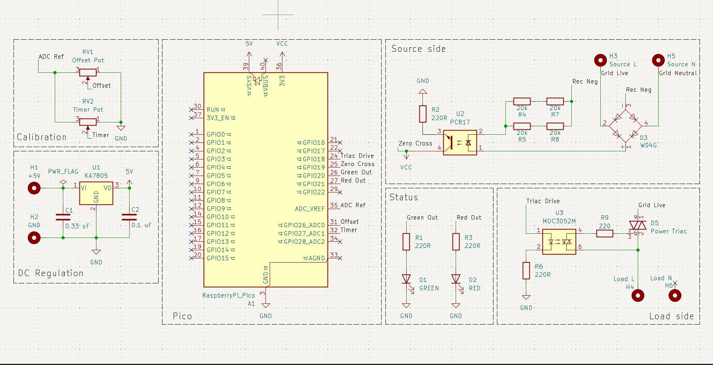
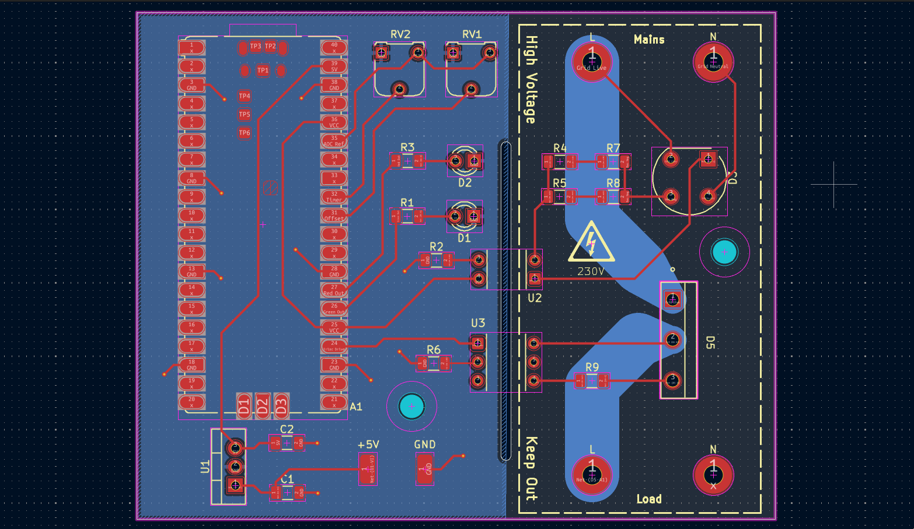

> [!WARNING]
> If you are trying to recreate this circuit. Proceed at your own risk.

# AC Motor Speed Controller

It is a simple speed controller for single phase AC motors rated for ~240V AC. It works by switching a triac with a delay measured after each zero cross point.

## PCB Design

Currently theres a misplaced Resistor R2 which causes the zero cross detection to fail. You have to do the following to fix it

1. Cut the trace coming from pin 36 to pin 25
2. Remove the R2 resistor and short it with a wire / solder
3. Connect a 220R resistor across pin 36 to pin 25

**Schematic**

**PCB Layout**

## Zero Cross detection

For detecting Zero cross, I used a PC817 optocoupler. On hindsight, using an optocoupler with lower forward current requirement would have made the design more effective. Currently the current limiting resistors run pretty hot, at around 1.4W per resistor max power dissapation.

## Triac Driving

- I am using BTA41-600B Triac for its high current rating, however this project does not reach near its limit, so it should have a good buffer for handling heat dissappation.
- MOC3052M Optoisolater is used to drive the Triac, it was the cheapest I could find :P

## Controller

The entire project is handled by an RP2040, standard Raspberry Pi Pico.

## Safety (or the lack there of)

Currently this project is just a proof of concept, so I have not designed any safety measures for the PCB and I am only relying on the breakers for overcurrent and short circuit protection.

The next version of the project will have the following safety precautions in place

- 10A fuse for over current protection
- A Metal Oxide Varistor for overvoltage protection
- RC Snubber across Triac to supress ringing

---
